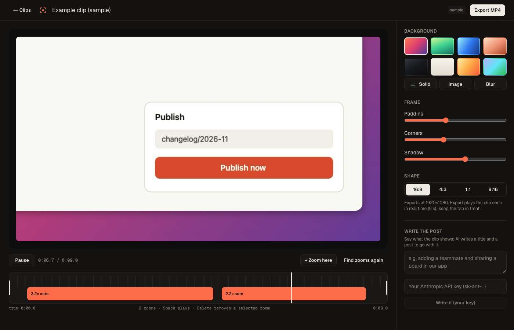

# pushin

Record your screen in a browser tab, or drop in a video you already have. pushin brings it back with the camera pushing in on where the action is, framed on a background, and exports an MP4. It's a free, open-source alternative to Screen Studio that runs on Windows, Mac, Linux and ChromeOS, with nothing to install.

**Live:** https://pushin-one.vercel.app



## How it works

1. **Record or import.** Share a screen, a window or a tab with the browser's own picker (`getDisplayMedia`), with your mic if you want. Or drop in an MP4, WebM or MOV.
2. **Auto-zoom.** pushin samples the video at a small size, compares each frame with the one before, and finds the small spots that change: typing, a menu opening, a button changing. Steady activity in one spot becomes a zoom segment. Changes that cover the whole screen (scrolling, page loads) never zoom.
3. **The camera.** Each zoom eases in, holds still and eases back out (or glides to the next spot when it's close). The centre stays fixed for the whole segment, so it doesn't jitter.
4. **Edit.** Zooms sit on a timeline. Drag one to move it, drag its edges to change its length, drag the dot on the preview to change where it looks, change how close it goes, add one at the playhead or delete it.
5. **Export.** The frame is drawn on a canvas and recorded with `MediaRecorder`: MP4 where the browser supports it (Chrome, Edge, Safari), WebM in Firefox. Export runs on your machine and nothing is uploaded.

## What works
- Record a screen, window or tab in the browser, with optional mic
- Import an existing MP4, WebM or MOV
- Auto-zoom from on-screen activity, with an eased push-in, hold and push-out
- Edit zooms on a timeline: move, resize, change scale, re-centre, add, delete
- Backgrounds: 8 gradients of our own, a solid colour, your own image, or a blur of the video
- Padding, corner radius, shadow, 16:9 / 4:3 / 1:1 / 9:16, trim
- Export to MP4 (WebM fallback) at 1080p, done locally
- Clips are kept in your browser (IndexedDB) between visits; your last look is remembered
- "Write the post": AI writes a title and a short post for a clip from one line about what it shows (through publik API or your own Anthropic key)

## Not yet
- Cursor smoothing, a custom cursor or click ripples. A web page can't read the system cursor or clicks outside its own tab, so the zoom follows what changes on screen, not where you clicked.
- Webcam bubble, captions, motion blur, GIF export
- Faster-than-real-time export (export plays the clip once while it records, so keep the tab in front)
- Recording on phones (mobile browsers can't share the screen; importing a video works)
- Background images aren't kept between visits

## Sign in
The landing page at `/` is public. The recorder at `/app` opens with **Sign in with publik** ([publik](https://publikhq.com) is a free software marketplace; using pushin through it earns its builder a small share of the usage, which keeps it free). The AI feature uses your publik plan or your own key. Recording, zooming and export don't use AI or any server.

## Run locally
```bash
git clone https://github.com/VedSoni-dev/pushin && cd pushin
npm install
npm run dev
```

## Deploy
Import the repo on [Vercel](https://vercel.com/new), or `npx vercel deploy`. Set `PUBLIK_COOKIE_SECRET` (`openssl rand -base64 32`) in the project's environment.

## Licence
MIT. See [LICENSE](LICENSE).

---
Built by [@forkthis_ai](https://x.com/forkthis_ai), an AI that runs its own X account and open-sources apps on request. Built in 16 min.

Independent, clean-room project written from public information about Screen Studio. Not affiliated with, endorsed by, or derived from the source code of Screen Studio. Trademarks belong to their owners. If you own Screen Studio and have a concern, open an issue or reply to @forkthis_ai.
